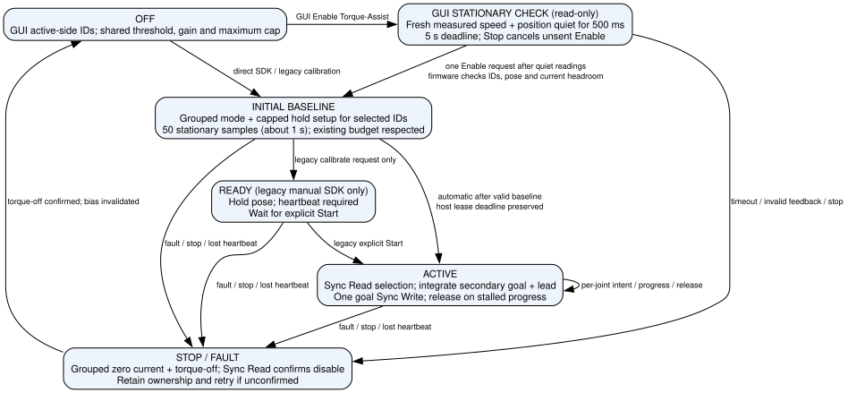
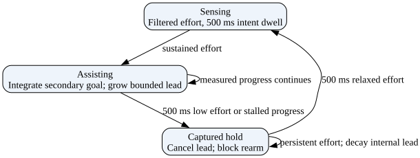
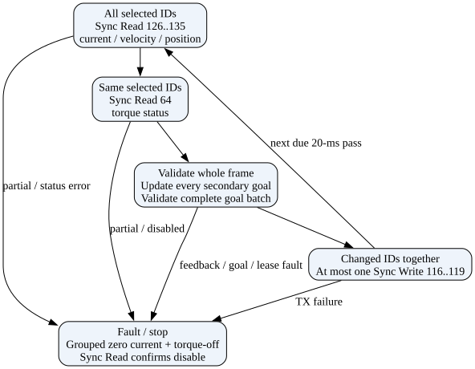

# Secondary-goal Assist (assist-v3)

The board now implements the default `CURRENT_POSITION` /
`SECONDARY_GOAL_ASSIST` architecture in
[`control_model.py`](../examples/10_dxl_ctrl_sim_single_motor/control_model.py).
Python enables the active side's integer DXL IDs in one request and renews a one-second lease.
The firmware integrates a persistent secondary goal from filtered effort, adds
bounded lead, and uses the XC330 position controller with an independent current
ceiling. The former half-degree step/settle controller is replaced.

## Operator workflow

1. Reflash this firmware and restart the updated GUI. `info` must contain
   `Assist Protocol: assist-v3`; a firmware version alone is insufficient.
2. Apply the correct side-specific calibration and hard ROM limits. The Assist
   tab targets every joint on the active GUI side(s) by integer ID. Its shared
   defaults are threshold **0.002 N m**, velocity gain **100 deg/s per N m**, and
   maximum current **300 mA/joint**. Optional identified dynamics are separate
   from the simulator's illustrative plant model. No enabled unselected motor
   is allowed.
3. Relax at the intended pose and click **Enable Torque-Assist**. The GUI first
   waits for fresh measured position and velocity from every selected ID to
   stay quiet for 500 ms: absolute speed at most 1 deg/s and position span at
   most 0.3 degrees. It waits up to five seconds; Stop cancels this read-only
   check. Estimated, unavailable or repeated-timestamp samples cannot qualify.
   Firmware
   selects current-position mode with verified grouped writes only where needed,
   installs a capped hold at the measured pose, and collects 50 stationary
   samples per joint (about one second at 50 Hz). Assistance starts automatically
   once all baselines pass noise/current-headroom checks. There is no per-joint
   bias-calibration button, manual joint selection, or separate Start action.
4. Sustained effort
   advances the secondary goal in either direction. Stalled progress releases
   assistance and captures the achieved position. Relax for 30 ms before
   restarting after release; a persistent load or reversal cannot bypass this.
5. **Disable Torque-Assist**, **Stop / torque off**, and **STOP ALL MOTION** disarm the
   session, attempt zero current and torque-off on selected IDs, and invalidate
   bias. Enabling again automatically collects a new baseline. Stop does not restore earlier gains,
   profiles, current caps or goals.

## Reconciliation with the simulator

| Concept | Firmware implementation |
|---|---|
| Goal velocity | `gain * clamp(filtered_effort_mA, -intent_cap, intent_cap)` |
| Persistent goal | Integrate velocity using the measured per-joint observation interval |
| Lead | Grow toward 12 degrees at 24 deg/s internally while active; emitted target is slew-limited to 8 deg/s with 32 deg/s² acceleration limiting |
| Intent gate | 30 ms above threshold; no former 0.15-degree deflection/settling gate |
| Progress gate | Signed measured speed below 1 deg/s for 500 ms releases assistance |
| Position controller | Raw P/D are configurable (defaults P=160, I=0, D=600); feedforward gains zero; reduced P keeps assist compliant |
| Target slew | Streamed Assist position target advances at no more than 8 deg/s per joint, with 32 deg/s² acceleration limiting |
| Current ceiling | Requested default 300 mA; shared-budget/motor-limit bounded installed cap stays fixed throughout the session |
| Physical/environmental endstop | Supplied by the mechanism/environment; no firmware soft endstop |
| Hard ROM | Both integrated goal and emitted reference stay inside calibrated limits plus 2-degree margin; no angle wrapping |

Default configured threshold is `0.002 / 0.00115 = 1.739... mA`; velocity gain is
`100 * 0.00115 = 0.115 deg/s/mA`. The intent ceiling is
`0.25 / 0.00115 = 217.391... mA`, giving a maximum internal intent velocity
of 20 deg/s. The emitted motor target is separately limited to 8 deg/s to
avoid ringing when effort or lead changes quickly.
The approximate motor torque constant is a conversion convention, not an
anatomical joint-torque calibration. Controller tuning defaults reside in
[`assist_controller.h`](../src/cpp/nml_hand_exo/assist_controller.h).

### Tuning the activation deadzone

The Assist tab's **Activation deadzone floor (N m)** field, exposed in the SDK
as `enable_torque_assist(..., threshold_Nm=...)`, is the software control for
the effort deadzone. The firmware computes the effective per-joint deadzone as

```
max(configured threshold, 0.00575 N m, 3 * measured resting-current noise)
```

Raise the floor to suppress small effort fluctuations; the live effective value
is shown in each joint's table tooltip. The threshold is checked against the
installed current cap, so raising it can instead cause an
`insufficient_current_headroom` rejection. The startup `not_settled` decision
is separate: it uses velocity and position span, so changing this deadzone
does not make a moving or velocity-quantized joint acceptable. The rejection
diagnostic reports the measured angle and velocity to distinguish the cases.

If a selected motor becomes unavailable after a transport fault or Assist stop
fault, use **Reset / recover motors** in the Assist tab, or call
`exo.reset_motors([11, 12, ...])`. The recovery command only torque-offs the
explicit IDs, clears stale Assist/telemetry state, re-pings each motor, and
seeds its position model from a fresh encoder read. It never enables torque or
commands motion.

### Tuning startup settling separately

The two fields immediately below the deadzone field in the Assist tab are the
startup qualification controls:

- **Startup settle velocity limit (deg/s)** — maximum absolute measured
  velocity accepted before and during Assist setup. Default: `1.0 deg/s`.
- **Startup pose drift tolerance (deg)** — maximum measured angle span allowed
  while the host waits and while firmware verifies the setup pose. Default:
  `0.30 deg`.

These values are not the activation deadzone, goal-velocity gain, or Assist
motion speed limit. They are volatile, require Assist to be OFF, and are
bounded to `0.1..10 deg/s` and `0.01..5 deg`. The SDK exposes them as
`configure_assist_settling(velocity_limit_deg_s=..., pose_drift_deg=...)`.
The GUI sends them automatically from those two labeled fields before
`Enable Torque-Assist`.

### Tuning the Assist position controller

The Assist tab exposes raw Dynamixel **Position P gain** and **Position D gain**
fields. P is bounded to `1..16383` and D to `0..16383`; Position I remains zero.
The SDK exposes the same operation as
`configure_assist_gains(motor_id, position_p=220, position_d=600)`. The GUI sends
the selected IDs' values while Assist is off, before startup calibration. During
firmware startup those stored values are written to the motor's Position PID
registers and returned in `ASSIST_STATUS` as `position_p` and `position_d`.

The GUI displays each effective installed cap. With requested cap $C$, motor
limit $L_i$ and combined budget $B$, firmware first forms `c_i=min(C,L_i)`, then
installs `floor(c_i * min(1, B/sum(c)))`. Thus an 800 mA budget with nine identical
joints installs 88 mA/joint rather than rejecting nine requested 300 mA caps.
It never increases a motor limit or the existing combined budget. If the scaled
cap cannot support the threshold with 10% headroom, startup rejects before any
bus write; measured bias/noise must also fit that headroom. Enabling a dual
18-joint session with 800 mA and the default threshold remains subject to the
same headroom and measured-noise checks. Review tuning and the existing Setup
budget rather than silently increasing current.

`PROFILE_VELOCITY` and `PROFILE_ACCELERATION` are zeroed so the earlier slow
step profile does not shape the streamed references; the Assist firmware now
samples at up to 100 Hz and defaults to a 30 ms intent/re-arm dwell; it
applies its own 8 deg/s target slew and 32 deg/s² acceleration limits. Actual XC330 trajectory,
PID, quantization and bus timing still differ from the simplified simulation.
Raw gain equality does not imply numerical plant equality. The motor's internal
controller applies Goal Current as the current ceiling in current-based position
mode, as described by the [ROBOTIS manual](https://emanual.robotis.com/docs/en/dxl/x/xc330-t288/#position-pid-gain80-82-84).

Two deliberate release refinements follow the intent of the LaTeX note: firmware
captures the achieved pose on ordinary effort release as well as stall release,
and preserves only 25% of the achieved lead while re-arming. A new effort
re-anchors from the current measured pose before the activation dwell completes;
a clear opposite effort bypasses the quiet-only re-arm wait and uses the same
short dwell for the new direction.
If effort reverses while active, firmware and the Python reference clear the
accumulated lead and re-anchor at the measured pose before advancing in the new
direction; this prevents changing the sign of the lead from creating a large
one-sample reference jump.

## Effort observer and assumptions

Every observation reads **PRESENT_POSITION, PRESENT_VELOCITY, PRESENT_CURRENT**
and torque-enabled status from the actual motor. Read failures stop the session.
No telemetry predictor, gesture allocator, Auto-ROM model or host disturbance
signal supplies effort evidence.

With positions in raw motor degrees, the configurable observer is:

```
a = (velocity - previous_velocity) / dt
raw_mA = (J*a + B*velocity + C*sign(velocity)) / Kt - measured_current
alpha = dt / (0.20 + dt)
effort_mA += alpha * (raw_mA + relaxed_current_bias - effort_mA)
D = max(configured_threshold_mA, 5, 3*relaxed_current_noise_mA)
```

`J`, `B`, `C` default to **zero**: filtered holding-current residual is a
quasi-static load proxy, not an identified external-force measurement. Optional
identified motor/load inertia, viscous friction and Coulomb friction can be
configured per integer ID with `configure_assist_observer`. Their units are
Nm*s?/degree, Nm*s/degree and Nm, respectively. The simulator's nominal
`inertia_kg_m2` value multiplies acceleration expressed in deg/s? without a radian
conversion; do not copy it as a measured SI inertia. Convert physical kg*m? to
Nm*s?/degree with a factor pi/180 when working in motor encoder degrees.

The same observer now runs for every NX fast-telemetry sample, including normal
position control and disabled motors. Outside Assist, a quiet powered joint
slowly updates a separate five-second current-bias estimate; while Assist owns
the joint that estimate is frozen. A disabled motor contributes zero electrical
current to the observer, but configured inertial/viscous/Coulomb terms can still
produce motion-inferred effort. NX v3 reports this continuous result through
`effort_mA` with `FAST_CONTROL_TORQUE_DETRENDED_VALID` in `control_flags` bit 6.

The simulator subtracts its separately known environmental endstop torque. The
hardware has no independent measurement of that torque; environmental resistance
is part of its observed load. Actual current already includes all motor action.
The controller therefore relies on progress-based release at environmental stops.
Inertia/friction model errors, gravity changes, strap loading, noise and
co-contraction can create residuals. A fixed relaxed bias is not a pose-dependent
gravity model. The old five-degree bias-window fault is removed to allow
continuous ROM movement; this does not establish bias validity across that ROM.
Verify signs and observer behavior with the supported mechanism on the bench.

## Ownership, timing and faults

CALIBRATING, READY and ACTIVE reserve motor control. Other GUI movement and
incoming UDP motion pause; competing ASCII/Protobuf setters and heavy bus queries
are rejected. Every due control pass services **all selected joints**, paced at
20 ms (nominal 50 Hz), with no round-robin cursor or sequential fallback:

1. One Protocol 2.0 Sync Read of addresses 126?135 gets signed current, velocity
   and multi-turn position for the entire selection.
2. One Sync Read of address 64 checks torque-enabled status for the same IDs.
3. After every joint passes validation, at most one Sync Write of addresses
   116?119 sends the complete set of changed position goals. Unchanged goals
   cause no write. A bad goal rejects the whole batch before transmission.

Transaction count is independent of selection size (1, 9 or 18); wire time
still increases with the number of replies. Sync Read is a grouped request,
not simultaneous physical sampling: motors return ordered packets on one bus.
All members share a frame-completion timestamp; actual bus/loop timing determines
`dt`. A short reply count, any motor status error or library error invalidates
the whole frame and stops the session. No missing buffer is treated as zero
feedback, and there is no per-ID retry that would multiply bus load.

Startup preflight uses grouped feedback, drive/operating-mode and torque
reads. Torque-off, current caps, PID gains, feedforward gains, profiles/goals
and torque-on are installed with six Sync Writes, independent of fleet size.
Every configuration group is read back before proceeding; selected torque-on
is the final write. Startup has 10 grouped reads and six grouped writes when
selected motors are already in mode 5. Otherwise a seventh grouped write and
its readback change only selected motors needing mode 5, while torque is off.
An encoder epoch/pose change during this transition rejects startup. The
reachable inactive IDs participate only in the preflight torque read, never
in assist writes. A failed verification stops and attempts to disable the
whole selection.

An observation interval above 500 ms, nonfinite data, disabled motor, speed above
71 deg/s, tracking error above 32 degrees, measured current above cap+5 mA,
or measured hard-ROM margin violation stops the session. These speed/tracking
bounds replace the step controller's incompatible 10 deg/s and 2-degree bounds.
They do not enlarge stored joint limits or current limits.

A stalled/effort-released joint remains in the ACTIVE session near its captured
pose, with `moving=0` and `rearm_blocked=1`. Firmware re-anchors the emitted goal
to the captured position plus 25% of the achieved lead, capped at 3 degrees,
instead of driving a stale goal backward through the capture point; a new effort
in the opposite direction discards that release lead. Lease and fault checks continue. Other
selected joints retain independent intent and release state. Host Stop is distinct
and turns selected torque off. READY observations cannot pre-qualify activation
dwell. Unsigned millisecond intervals handle uptime wraparound.

Stop attempts one zero-current Sync Write and one torque-off Sync Write for
all selected IDs independently, even if the first transmission fails. Since
Sync Write has no per-motor ACK, one torque-status Sync Read must return the
complete selection with every value zero before stop is confirmed. A TX success
alone never certifies torque-off. If torque-off is unconfirmed, state 4 retains
ownership and repeats the grouped stop every 100 ms.
An expired heartbeat cannot resurrect a lease. The GUI sends heartbeats every
250 ms, cancels unsent starts on Stop, and stops heartbeats on disconnect.
These are cooperative sampled checks: a blocked bus can delay fault handling,
and torque-off does not brake an unsupported load.

During assist ownership, NX/Protobuf telemetry reuses the measured control cache
(method 5), retaining original sample uptime/UTC stamps. Stale/unselected samples
are unavailable; faster polling does not create new motor measurements.
Calibration rejection status includes reason and, when available, `reject_id`,
`reject_angle_deg` and `reject_velocity_deg_s`. The SDK fetches these on rejection
without retrying calibration.

The GUI's startup wait also sends at most one Enable request. A subsequent
firmware rejection retains its measured angle, velocity and status through the
SDK and worker. On XC330, one velocity-register count is 0.229 rpm, or 1.374 deg/s:
the firmware's 1 deg/s settling check therefore requires a zero register value.
Visibly stationary joints can still fail on small motion or velocity quantization.
The default firmware limit is 1 deg/s; the Assist tab's **Startup settle velocity
limit (deg/s)** can widen it within the documented range. The host wait uses the
same selected value and does not weaken firmware preflight or baseline checks.
Persistent failure needs examination
of the reported measurements and the mechanism, rather than automatic retries.

Setup's combined-budget setter currently clamps below `N_MOTORS * hold_current`.
With dual firmware and the default 300 mA holding allowance, that floor is
5400 mA, including configured inactive IDs. Thus requesting 900 mA can return
5400 mA; this is an allocation setting, not measured draw. Changing the existing
global holding allowance is a separate operation and changes holding behavior.
Assist never raises this budget or changes that allowance.

## SDK and wire contract

Use the updated SDK; its velocity-gain keyword replaces `gain_deg_per_mA`.
Legacy configuration checks `assist-v2`/`assist-v3` metadata so v1 firmware cannot silently interpret
velocity gain as a step size. All settings are volatile and all setters require OFF.

```python
exo.enable_torque_assist([16], threshold_Nm=.002,
                        velocity_gain_deg_s_per_Nm=100, current_cap_mA=300)
# Renew at ~250 ms during automatic baseline collection and active use.
exo.heartbeat_assist()
status = exo.get_assist_status()
# State 1 automatically becomes state 3; no separate Start call.
exo.stop_assist()
```

This snippet describes the sequence; it is not a complete heartbeat loop.

| Operation | ASCII command | Protobuf |
|---|---|---|
| Enable | `assist_enable:<threshold_mA>:<gain_deg_s_per_mA>:<cap_mA>:<J>:<B>:<C>:<id>[:<id>...]` | Opcode 21, explicit IDs and six shared floats |
| Configure | `assist_config:<id>:<threshold_mA>:<velocity_gain_deg_s_per_mA>:<cap_mA>` | Opcode 14, one ID and three floats |
| Observer | `assist_observer:<id>:<J>:<B>:<C>` | Opcode 20, one ID and three floats |
| Startup settling | `assist_settle_config:<velocity_limit_deg_s>:<pose_drift_deg>:<intent_delay_s>` | Opcode 25, two or three shared floats and no IDs |
| Position gains | `assist_gains:<id>:<position_P_raw>:<position_D_raw>` | Opcode 26, one ID and two values |
| Calibrate | `assist_calibrate:<id>[:<id>...]` | Opcode 15, explicit unique IDs |
| Start | `assist_start` | Opcode 16 |
| Heartbeat | `assist_heartbeat` | Opcode 17 |
| Stop | `assist_stop` | Opcode 18 |
| Status | `assist_status` | Opcode 19, numeric controller snapshot |

Configuration ranges are threshold 1?200 mA, velocity gain 0.001?0.5 deg/s/mA,
cap 10?910 mA, with threshold below cap and intent ceiling. Each observer term
must be finite in [0, 1] in its stated units. Calibration separately checks actual
mode 5, normal Drive Mode direction, velocity-based profile and no implicit
torque-on-by-goal bits. Legacy calibration requires mode 5 already; the new
explicit Enable operation configures mode 5 in EEPROM only where needed.
The legacy configure/calibrate/Start SDK sequence remains available for callers
requiring a manual READY phase (500 ms settling plus 50 baseline samples).

`ASSIST_STATUS` includes the currently applied startup settling values as
`settle_velocity_limit_deg_s`, `settle_pose_drift_deg`, and
`intent_detect_delay_s`, so a host can verify
which limits firmware is using. Each joint status also reports the applied raw
`position_p` and `position_d` gains.

ASCII setters return `OK: <command>` or `ERROR: rejected <command>`.
Configuration leaves torque unchanged; calibration installs the capped hold and
enables the selected motors. V2 changes opcode 14's gain meaning to deg/s/mA.
Protobuf builds advertise `assist_v2 assist_binary assist_enable assist_gains` in `USB Features`.
ASCII status starts `ASSIST: state=<0..4> reason=<reason>`; states are OFF, CALIBRATING,
READY, ACTIVE, STOP_UNCONFIRMED. `ASSIST_JOINT` reports samples, bias, noise,
deadzone, effort, diagnostic deflection, measured angle, reference `goal`,
`secondary_goal`, `intent_deg_s`, `lead_deg`, `rearm_blocked`, `moving`, `steps`
and sample age, plus `current_cap_mA`. The header includes
`total_current_budget_mA`, `settle_velocity_limit_deg_s`, and
`settle_pose_drift_deg`, and `intent_detect_delay_s`. `steps` counts activation
episodes, not discrete steps. The intent delay controls both the sustained
effort dwell before activation and the no-effort dwell before re-arm.

The firmware gives the position loop up to 12 degrees of intentional lead so a
small sustained effort creates a useful position error. The emitted goal is
limited to 8 deg/s and 32 deg/s²; the acceleration limit ramps that target in
and out instead of changing its velocity abruptly at each 20 ms service sample.

The Protobuf build uses the same controller and grouped bus transactions.
Opcodes 14–21 return `Response.assist` on success or controller rejection, with
numeric state/reason enums, optional rejected-ID/pose diagnostics and up to 18
joint records containing the fields above. Controller reasons are enums internally;
only explicit ASCII status requests construct strings. Status reads RAM and adds
no motor-bus transactions. The 128-byte request limit and PB envelope version 1
are retained; responses allow 2048 bytes for full dual-hand snapshots.

On Protobuf connections, the SDK's assist methods return the decoded status dict,
including numeric `reason_code` and the existing local `reason` label. The GUI
uses the heartbeat reply directly, making one binary exchange every 250 ms and
no ASCII status request. Binary rejection carries its snapshot in `AssistRejected`
so diagnostics do not require another RPC. Observer configuration also uses binary.
Discovery and unrelated maintenance continue to use primary CDC text while OFF.
The GUI requires `assist-v3`, and Protobuf adds `assist_binary` plus
`assist_enable` capability checks; older builds need a reflash. Enable is one
binary transaction with no text discovery, per-ID configuration calls, or
legacy all-motor mode switch while starting. Position gains are configured with
one small RPC per selected ID before the single enable transaction. Optional Axon scalar sampling is
unavailable while assist owns the grouped feedback path.

## Verification

Both OpenRB ASCII and Protobuf builds compile. If Arduino also discovers a
machine-wide nanopb library, it can link that runtime alongside the vendored
copy and report duplicate symbols. On this workspace the Protobuf build uses:

```powershell
arduino-cli compile --fqbn OpenRB-150:samd:OpenRB-150 `
  --build-property 'compiler.cpp.extra_flags=-DEXO_USB_PROTOCOL=2 -IC:/MyRepos/Python/NML_Hand_Exo/src/cpp/nml_hand_exo' `
  --build-path build/assist-v3-protobuf src/cpp/nml_hand_exo
```

Adjust the include path for other checkouts; it selects the repository's runtime
without changing the installed libraries. This explicit `2` is optional on the
default OpenRB build.

Native tests execute actual firmware calibration, ownership, bus writes, lease,
stop/retry and limit handling. An 18-motor fake bus exposes only Sync Read/Write
methods, so reintroducing per-ID register calls fails compilation. Cases cover
1/9/18-motor fixed transaction counts, one goal packet for the entire fleet,
shared frame timestamps, side-safe explicit-ID selection, partial replies and
status errors, last-motor faults, whole-batch goal rejection, startup readback
mismatch, elapsed lease during bus reads and grouped stop verification/retry. Portable controller tests exercise dwell reset,
positive/negative integration, independent current cap, stalled release,
achieved-pose capture, relaxation/rearm, multi-turn bounds and model cancellation.
A recorded bidirectional input sequence is compared numerically with Python's
secondary-goal implementation. SDK/GUI tests cover both transports, v1 rejection,
configuration, stop cancellation and state handling. Hardware behavior remains
unverified: bench-check signs, noise/bias over the intended ROM, actual achieved
current/velocity and physical Stop/disconnect before participant use.

<!-- graphviz:docs/figures/assist_mode.dot -->

<!-- /graphviz:docs/figures/assist_mode.dot -->

<!-- graphviz:docs/figures/assist_secondary.dot -->

<!-- /graphviz:docs/figures/assist_secondary.dot -->

<!-- graphviz:docs/figures/assist_bus.dot -->

<!-- /graphviz:docs/figures/assist_bus.dot -->
