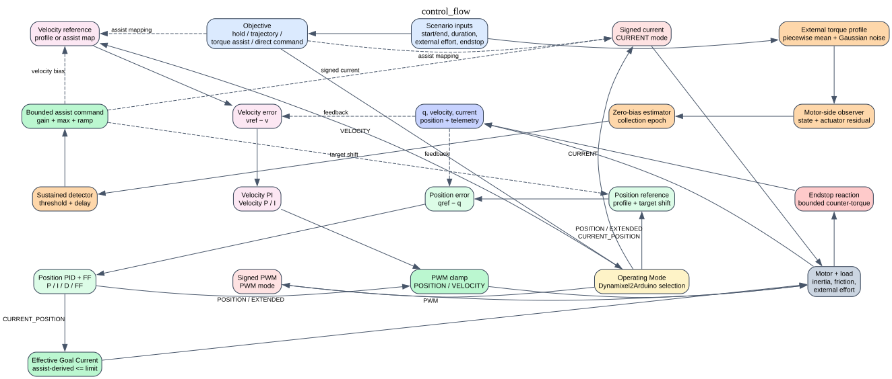

# Single-motor Dynamixel control simulator

This example is a hardware-independent visual sandbox for the XC330-style low-level control modes exposed by `Dynamixel2Arduino`:

- `OP_POSITION` / raw Operating Mode `3`
- `OP_EXTENDED_POSITION` / raw `4`
- `OP_CURRENT_BASED_POSITION` / raw `5`
- `OP_VELOCITY` / raw `1`
- `OP_CURRENT` / raw `0`
- `OP_PWM` / raw `16`

Run it with:

```powershell
python examples/10_dxl_ctrl_sim_single_motor/simulator.py
```

To compile the LaTeX PDF:

```powershell
latexmk -pdf control_logic_assist.tex
```

The top panel dynamically redraws the selected control path. Blocks appear or disappear with the operating mode and objective; animated, color-keyed arrows show position, velocity, current, torque, feedback, and endstop signals. Line width follows the live signal amplitude. The overview is intentionally bounded to a few clickable groups; hover a group to highlight it, click to inspect its internal flow, and use the breadcrumb at the top to return. The lower panel contains the editable scenario and a 2D servo/arm view. Drag the `start`, `end`, and enabled `soft endstop` handles around the range arc; click the external- or assist-torque value labels to edit them inline. Changing `start` at the beginning of a run moves the initial arm immediately; after playback has advanced, press Reset to apply a new start position.

The controls are filtered by operating mode: position gains and target/profile inputs appear for position modes, velocity gains for velocity mode, direct current for current mode, and direct PWM for PWM mode. The objective selector also removes objectives that cannot drive the selected low-level path.

The main window keeps the parameter panel at the left and full height. The
right side is split vertically between the compact control-transformation
flow and the simulated motor view.

`External-effort assist` adds a configurable piecewise-linear mean profile and
Gaussian noise. During the zero-collection epoch the observer estimates the
motor's external-effort bias. Afterward it subtracts that bias, smooths the
residual, waits for the detection threshold to persist, and ramps a bounded
assist command. In `CURRENT` mode that command is signed current/torque; in
position or velocity modes it is mapped into the corresponding reference.

Playback can be slowed independently of the controller timestep. For example, `0.10×` advances 100 ms of simulated motion per one second of wall time.

## What the simulation means

The model is intentionally simplified. It is useful for comparing control architectures and sign conventions, not for predicting an XC330 response.

- `POSITION`, `EXTENDED_POSITION`, and `CURRENT_POSITION` use a position reference and a simplified position PID.
- `CURRENT_POSITION` uses an effective Goal Current. The default `Torque assist (secondary goal)` objective keeps Goal Current as an independent ceiling while a sustained debiased effort drives an intent velocity, persistent secondary goal, and bounded lead. The legacy `Torque assist (dynamic current cap)` objective remains available for comparison and derives a lower effective current limit from the live assist request.
- `VELOCITY` uses a simplified velocity PI loop.
- `CURRENT` applies signed current directly as torque.
- `PWM` applies a normalized signed PWM effort.
- In `Torque assist (secondary goal)` mode, position modes use a compliant moving target: low P, little/no I, damping D, a persistent secondary goal, and a bounded lead. If measured progress stalls, the lead is released and the achieved position is captured without clamping the reference to the soft-endstop coordinate.
- `External-effort assist` generates a piecewise-linear external-torque mean, adds configurable Gaussian noise, estimates external effort from motor state and actuator output, learns a zero bias during the collection epoch, and only ramps assist after a threshold is sustained for the detection delay.
- External torque and soft endstop reaction torque are applied in the plant.

The raw PID fields retain the XC330 control-table conversions (`P/128`, `I/65536`, and `D/16`), followed by a clearly marked simulation normalization. This keeps the UI tied to the real register concepts without claiming that the simulator is a motor-identification model.

## Flow Control
  
The static [GraphViz control-flow source](control_flow.dot) and its rendered SVG remain available as documentation artifacts; the application itself uses the dynamic Qt renderer so the displayed path follows the current selections.

## Focused assist-control reference

For the proposed `CURRENT_POSITION` + `TORQUE_ASSIST` architecture, use the
focused [five-stage GraphViz diagram](control_logic_assist.svg), whose editable
source is [control_logic_assist.dot](control_logic_assist.dot). It separates the
debiased effort estimate, intent velocity, persistent secondary goal, bounded
lead, compliant PID effort, independent current ceiling, and applied plant
torque.

The implementation-derived algorithm and equations are maintained in
[the LaTeX source](control_logic_assist.tex) and compile-validated with the
repository LaTeX toolchain. In particular, they document that the 300 mA Goal
Current setting is an independent safety/compliance ceiling for the default
secondary-goal objective. The legacy dynamic-current-cap objective remains
documented for side-by-side comparison.
